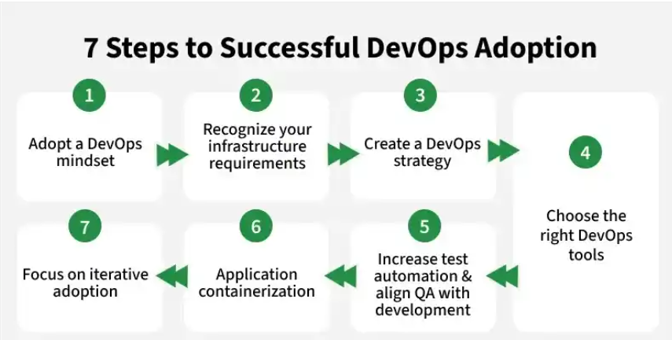

# What is DevOps?

## Definition 

DevOps is a set of practices that are implemented in order to reduce the software development lifecycle. These practices include automation, collaboration, and continuous improvement to get quick feedback, all under the guise of the agile methodology. 

DevOps combines Development and Operations which is a transformative approach that enhances collaboration and automation between the teams of developers, operations, and IT. The core objective of DevOps is to simplify and fasten the CI/CD process while maintaining the stability and reliability of software at the same time.

---

## Stages of Devops 

### Stage 1: Plan 

Defining project goals, requirements, and task breakdowns to align development and operations teams.

- Work is broken down into tasks and user stories to ensure clarity and alignment.
- Collaboration between development and operations begins at this stage to avoid future bottlenecks.
- Tools: Jira, Trello 

### Stage 2: Code 

Writing, reviewing, and managing application source code and configurations using version control.

- Code reviews and branching strategies help maintain code quality and stability.
- Tools: Git, GitHub, GitLab, Bitbucket.

### Stage 3: Build 

Automatically compiling and packaging code into deployable artifacts while resolving dependencies.

- Build automation ensures faster feedback and reduces manual errors.
- Tools: Jenkins, GitLab CI/CD, Maven, Gradle, Docker.

### Stage 4: Test

Running automated quality, security, and performance checks to identify bugs before release.

- Different Testing methods includes unit, integration, performance, and security testing.
- Issues are identified early, that will reduce the cost and impact of failures.
- Tools: Selenium, JUnit, TestNG, SonarQube, JMeter

### Stage 5: Deploy 

Pushing the application into production environments using automated infrastructure and rollout strategies.

- Deployment strategies such as blue-green, canary, or rolling updates are used to ensure minimal downtime.
- Tools: Kubernetes, Helm, Ansible, Terraform.

### Stage 6: Operate and Monitor

Maintaining system health and gathering real-world performance data to drive continuous improvement.

- The application is continuously monitored to ensure availability and performance.
- Logs, metrics, and alerts help detect and resolve issues quickly.
- Feedback from monitoring and users is fed back into the planning stage for continuous improvement.
- Tools: Prometheus, Grafana, ELK Stack, Datadog, New Relic

