## Auto Scaling Redeployment 

### What is it?
An Auto Scaling Group manages a collection of EC2 instances. It can launch or remove instances according to demand and replace unhealthy instances.

- **Desired capacity:** the number of instances the group aims to maintain.
- **Minimum capacity:** the lowest number of instances allowed.
- **Maximum capacity:** the highest number of instances allowed.

### Why am I learning it?
Managing instances automatically helps an application handle changing demand and recover from instance failures without manually creating replacements.

## Application Load Balancer (ALB)

### What is it?
An Application Load Balancer receives HTTP or HTTPS requests and distributes them across healthy application targets, such as my EC2 instances.

A **listener** receives incoming connections on a configured port. A **target group** identifies the application targets to which requests are forwarded and defines their health checks.

### Why am I learning it?
When several instances run the same application, users need one address to access it. The load balancer distributes requests and directs traffic to healthy targets.

### How I used it
My load balancer receives HTTP traffic on port 80 and forwards requests to the app instances in its target group. Users access the application through the load balancer’s DNS name.

### Launch Template 

A launch template is a saved set of instructions for creating an EC2 instance.
- AMI: the image to launch.
  - 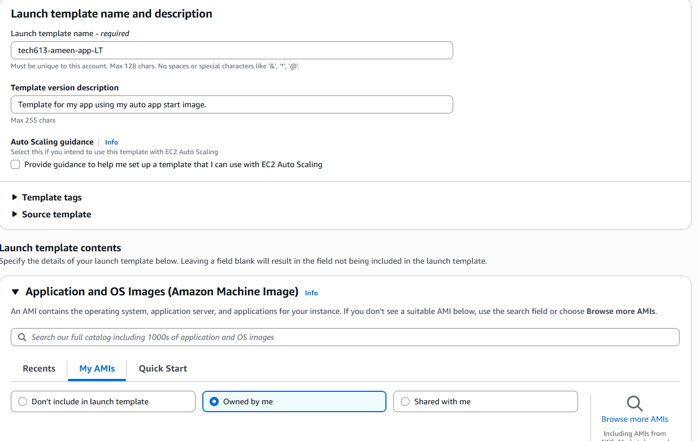
- Instance type: for example, t3.micro.
  - 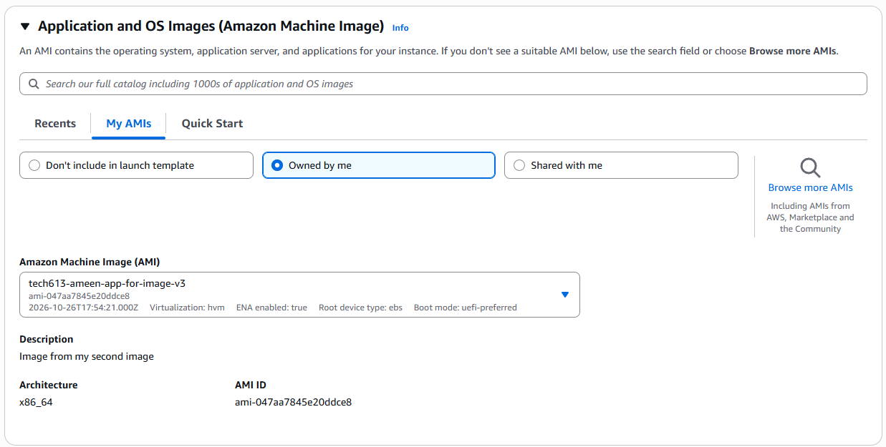
  - 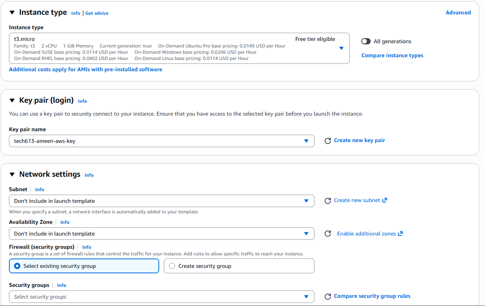
- Key pair: for SSH access.
- Security group: the network access rules.
  - 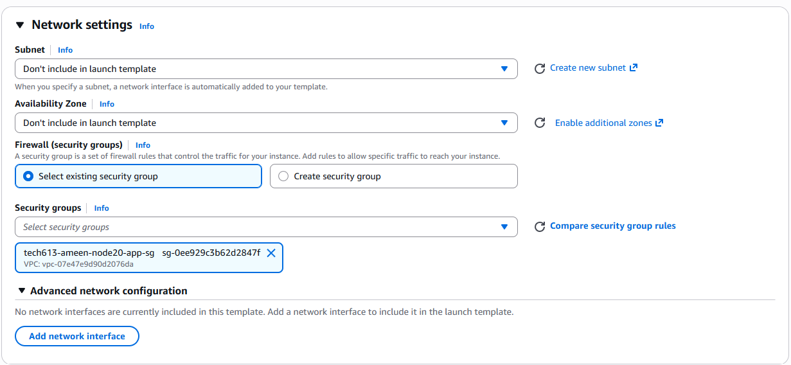
- Storage and user data: the disk settings and any startup script.

The Auto Scaling group uses this template whenever it creates another app instance, so I don’t have to fill in the form myself.
AMI = what is installed and configured. Launch template = the settings used to launch it.

### Auto-Scaling 

1. In the EC2 left-hand menu, I scroll down to **Auto Scaling -> Auto Scaling Groups**.
2. I click **Create Auto Scaling group**.
3. I enter **tech613-ameen-app-ASG** as the name.
   - 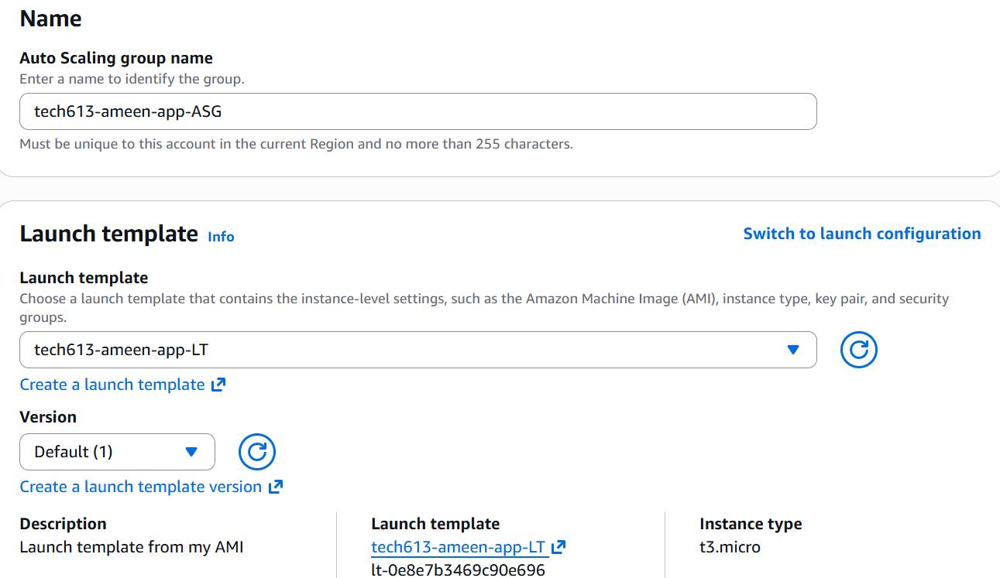
   - 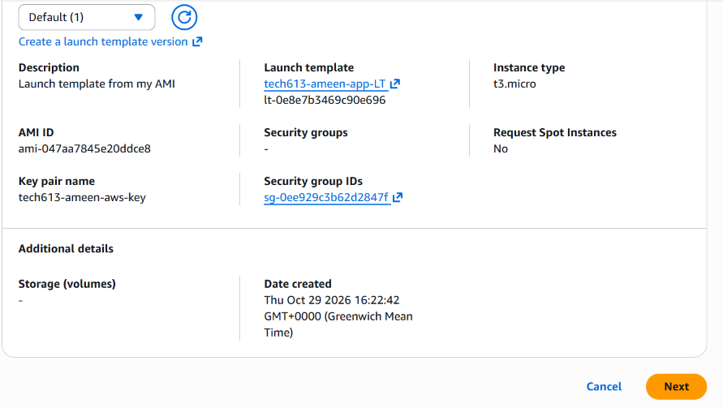
4. I leave the instance type requirements as is.
5. I leave the network vpc as default and choose the availability zones -1a, -1b and -1c
   - 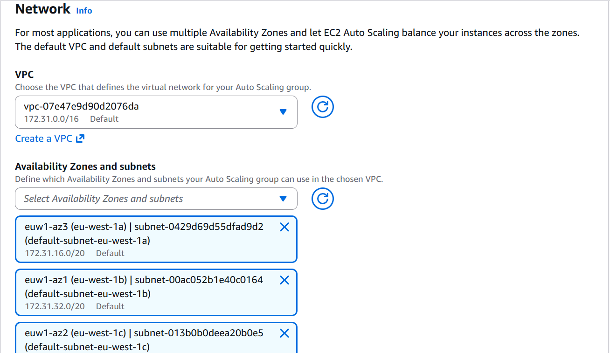
6. I leave the Availability zone distribution as is.
7. I leave the additional capacity settings as is. 

1. I select Attach to a new load balancer.
2.  I choose Application Load Balancer- this is being selected because the app uses HTTP.
3. For its name, I use tech613 naming convention plus -LB.
4. I set Load balancer scheme to Internet-facing.
5. I leave the inherited VPC and all three subnets/availability zones selected.
  - 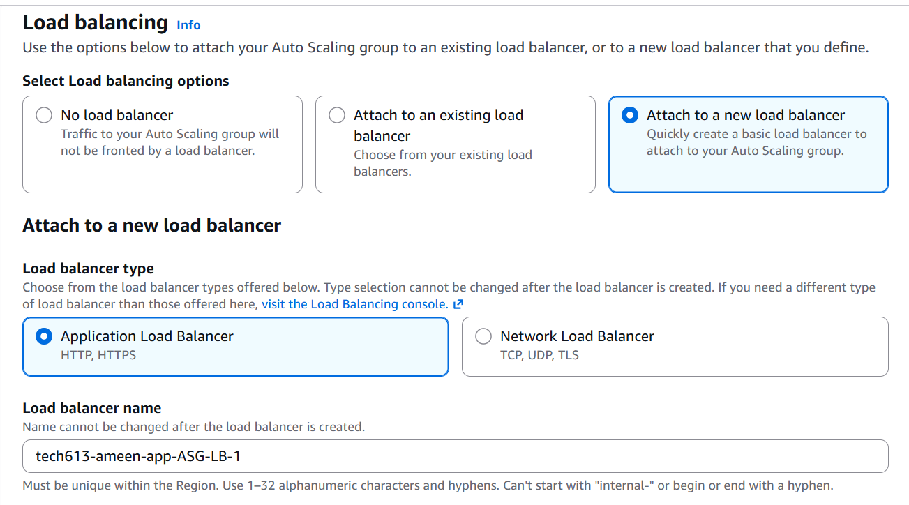
  - 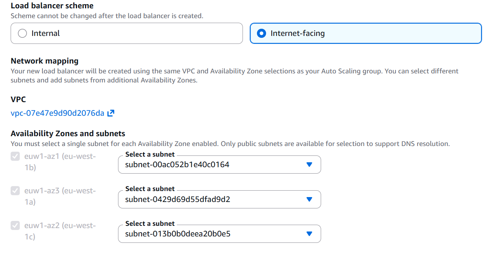
6. Protocol: HTTP.
7. Port: 80- I leave the default.
8. I open the target group dropdown and create a target group
9. I name it using load balancer’s name with -TG added at the end orany other appropriate name. 
  - 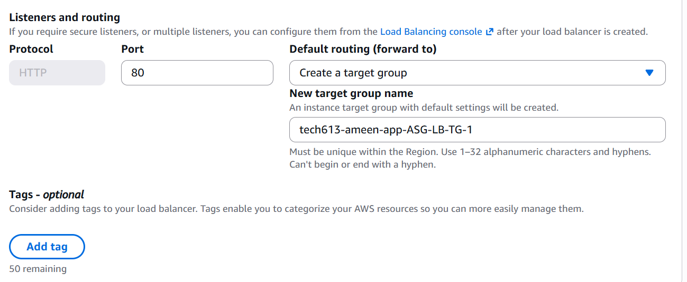

Then I scroll down:
1. VPC Lattice integration: I skip.
2. ARC zonal shift: I skip.
3. Elastic Load Balancing health checks: I enable.
4. Health check grace period: I leave at 300 seconds.
  - 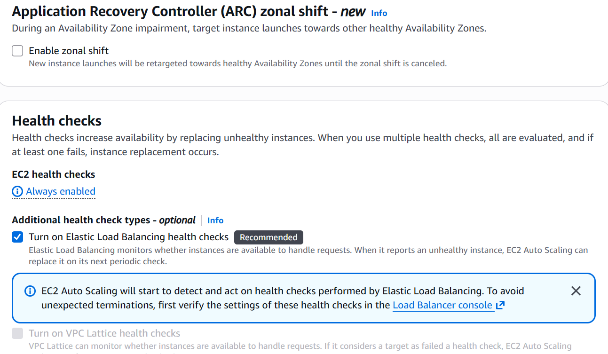
  - 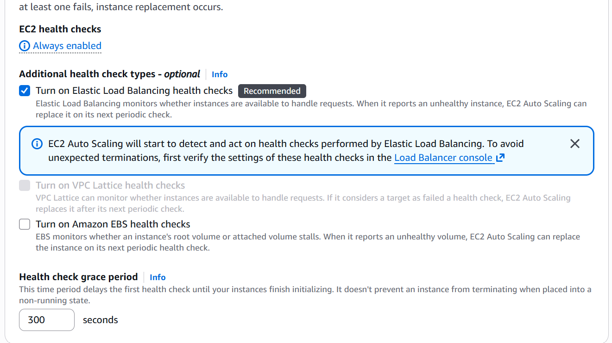

| Setting | Value |
|---|---|
| Desired capacity | **2** |
| Minimum capacity | **2** |
| Maximum capacity | **3** |
| Automatic scaling | **Target tracking scaling policy** |
| Metric | **Average CPU utilization** |
| Target value | **50** |
| Instance warmup | **Leave the default** |
- 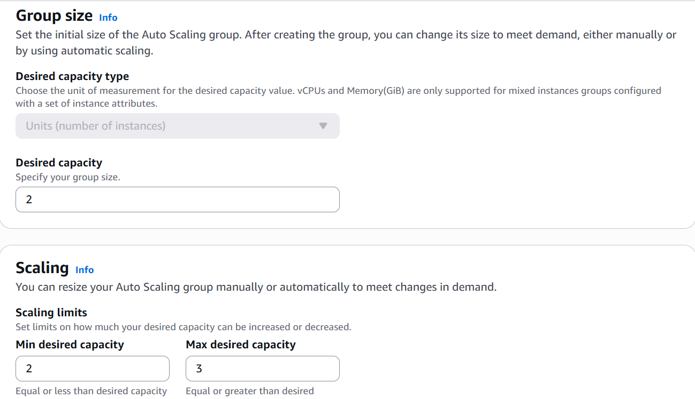
- 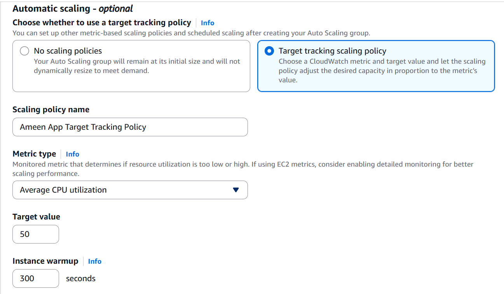

1. I select no policy for the instance maintenance policy. 
2. I leave all other selections for that section unchanged. 

1. Notification section is used to add alarms in case something is actioned via the ASG but for now this is left as default.
2. For the tags section I use name as the key capitilising the first letter. 
3. I make value `tech613-ameen-app-asg-has`. 
4. I keep tag new instances checked. 
  - 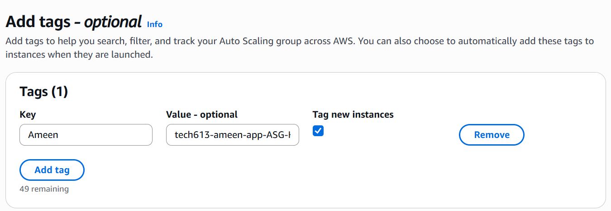

Finally, I select **Create Auto Scaling Group**

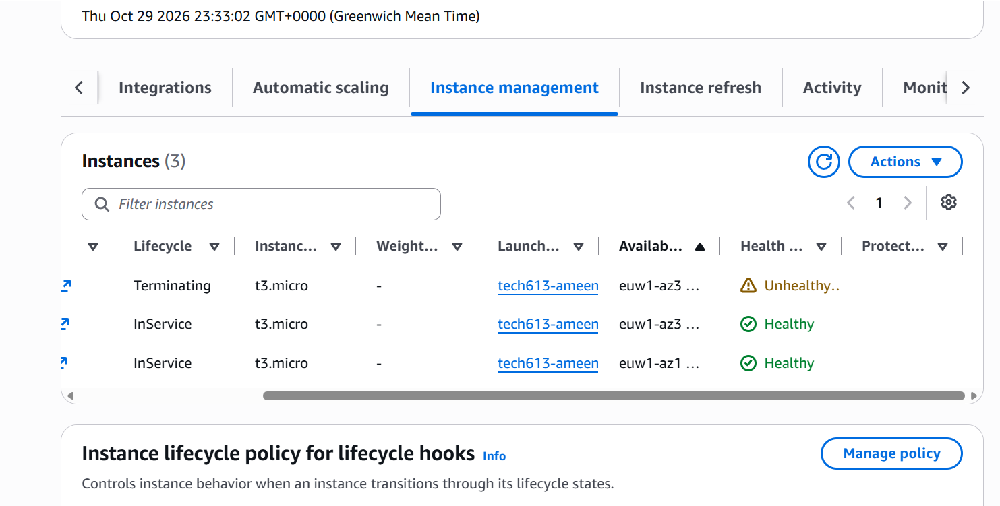

### Correct Order To Delete Everything

1. I delete Auto Scaling group - EC2 - Auto Scaling Groups - select mine - Actions - Delete. 
  - This also terminates its instances; I allow time for completion.
2. I delete load balancer - EC2 - Load Balancers - select mine - Actions - Delete.
3. I delete my target group - EC2 - Target Groups - select mine - Actions - Delete.
4. I check Instances to confirm the group’s instances have terminated.

