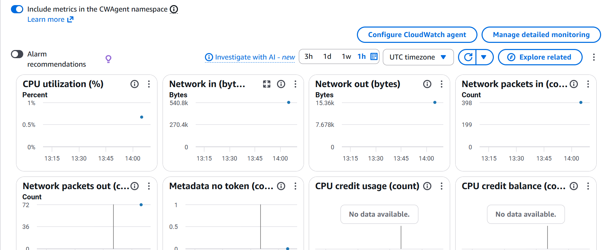
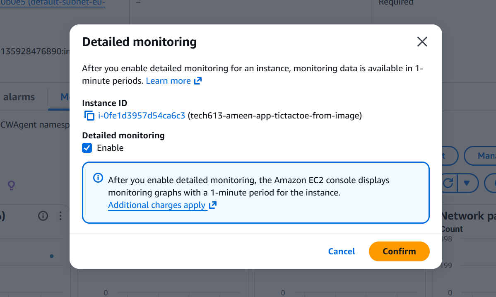
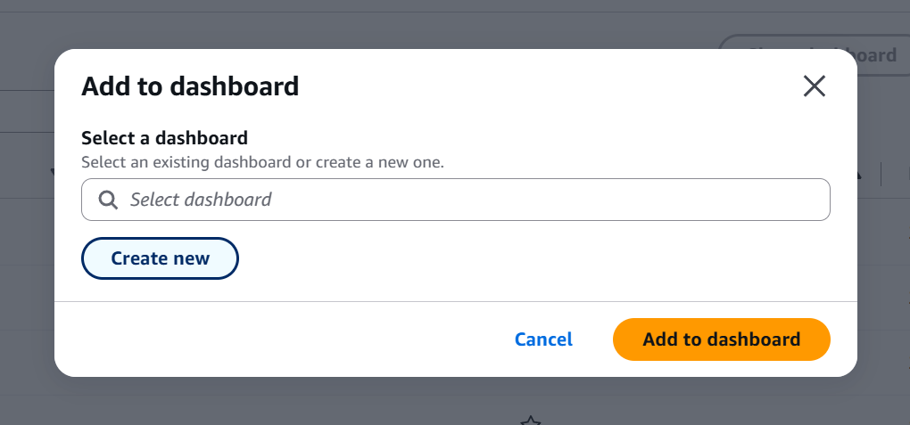
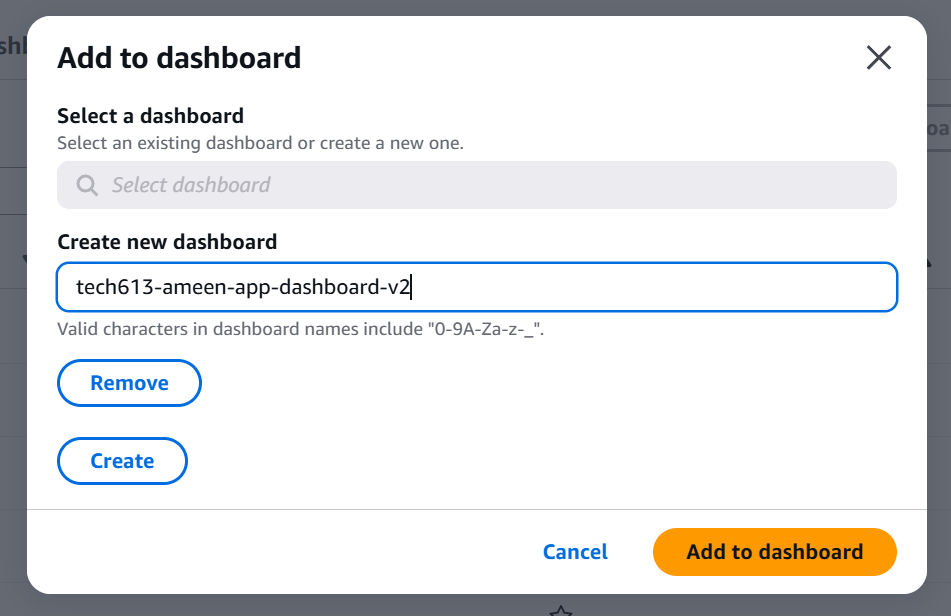
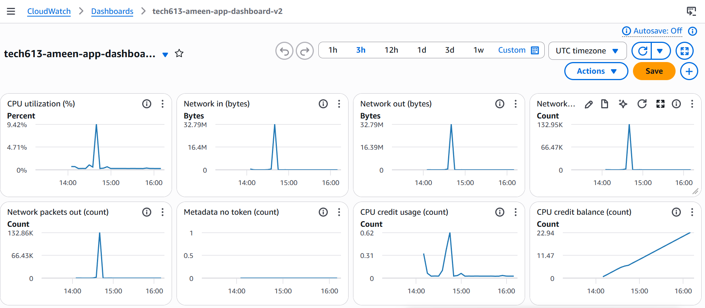
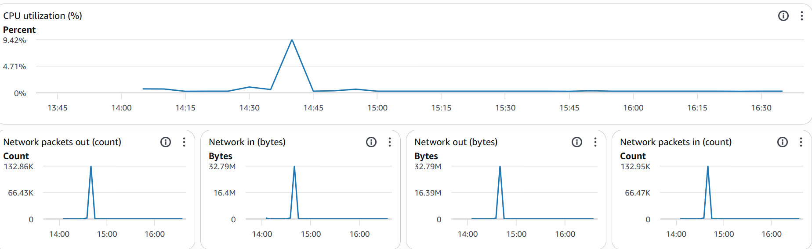
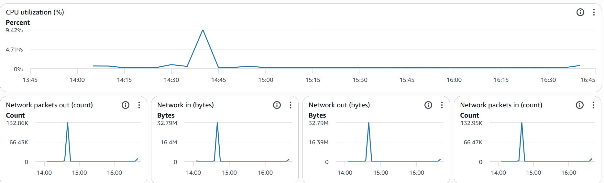
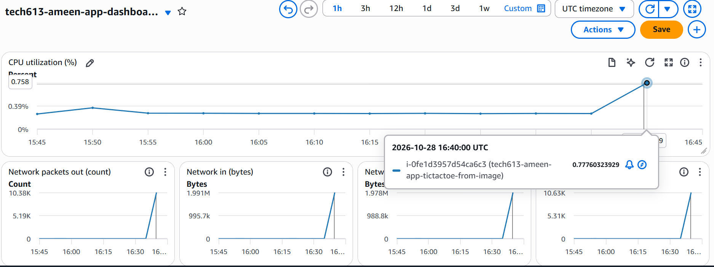

## Dashboard Setup 

1. Once the instance for the app has been created I go to the instance summary page and scroll down the navigation bar and find monitoring. 
2. The widgets provided to use gives a basic overview of the app instance's traffic but not neccessarily a dashboard or customisable. 
   - 
3. Just below the monitoring navigation bar I select manage detailed monitoring and enable the detailed monitoring button. 
   - 
   - 
4. Once selected, I click on the confirm button and then select the three vertical buttons which will reveal a singular drop down button asking to add to dashboard, I select this button as well. 
5. This will open up a new tab in which I will be propmted to add to dahsboard.  
   - At this point I select the **create new** button 
   - 
6. At this point I use the regular **tech613** naming convention to nash the dashboard then select create again and finally select the orange **add to dashboard** button. 
   - 
7. At this point the dashboard has now been created and is customisable to taste/need. 
   - 

## Load testing 

**apache2-utils** is the Ubuntu package containing ApacheBench.

1. First I need to download apache onto the virtual machine. 
   - `sudo apt-get install apache2-utils -y`
2. Now I can deploy simulated traffic onto the app, which I can check on the dashboard 
3. `ab -n 1000 -c 10 http://<APP-PUBLIC-IP>/`
   - `ab` calls Apache Bench.
   - `-n` is used to specify the number of requests simulated.
   - `-c` is used to specify the number of concurrent requests.
   - `http://<APP-PUBLIC-IP>/` is used to specify where to send requests.

### Real Tests 

#### Pre-test readings:

- 

#### Test: 

- `ab -n 30000 -c 500 http://54.217.189.32/`

#### Post-test readings:

- 
- 