## VPC Redeployment Overview

1. I create the VPC. This establishes the network and address range.
2. I create the subnets. This provides places for the instances.
3. I create and attach the internet gateway. This prepares the internet connection component.
4. I configure the public route table. This associates the public subnet and adds the internet-gateway route.
5. I launch the database instance in the private subnet.
6. I launch the app instance in the public subnet and configure its database connection.

I leave the private subnet without a direct internet-gateway route. Otherwise, the isolation intended could be changed.

The VPC resource map is a visual view in AWS showing my VPC’s subnets, route tables and network connections.

This is used to check that the network matches my planned architecture before launching the instances.

### Database in the private subnet

| Setting | Reason |
|---|---|
| Prepared database AMI | MongoDB is already installed and configured. |
| Private subnet | Keeps the database without a direct internet-gateway route. |
| No public IP | The app connects using the database’s private IP. |
| MongoDB port `27017` from `10.0.2.0/24` | Allows connections from my app subnet. |
| SSH port `22` from `10.0.2.0/24` | Allows access through a machine in the app subnet if needed. |

### App in the public subnet

| Setting | Reason |
|---|---|
| Prepared app AMI | App files, Node.js, dependencies, Nginx and PM2 are already installed. |
| Public subnet | Provides the internet route needed for this deployment. |
| Public IP enabled | Gives users an address through which to reach the app. |
| HTTP port `80` from anywhere | Allows users to access the website. |
| SSH port `22` from my IP | Restricts direct SSH access to my current public IP. |


## VPC-Setup

1. I open AWS and select Ireland (eu-west-1).
2. Search for VPC and open it.
3. I click Create VPC.
4. I select VPC only.
5. Enter: 
   - | Setting | Value |
|---|---|
| Name tag | `tech613-ameen-second-vpc` |
| IPv4 CIDR manual input | `10.0.0.0/16` |
| IPv6 CIDR | No IPv6 CIDR block |
| Tenancy | Default |

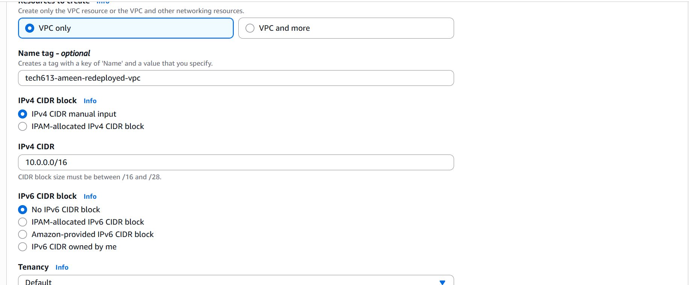

### What and why 

This creates the virtual network and its address range. Then I create two subnets inside it, one for the app and one for MongoDB.

## Create both subnets

1. In VPC, I select Subnets then Create subnet.
2. I select my VPC: tech613-ameen-redeployed-vpc.
3. I enter the public subnet settings:
   - | Setting | Value |
|---|---|
| Subnet name | `tech613-ameen-public-subnet` |
| Availability Zone | `eu-west-1a` |
| IPv4 VPC CIDR block | `10.0.0.0/16` |
| IPv4 subnet CIDR block | `10.0.2.0/24` |

4. I click **Add new subnet and enter**:
   - | Setting | Value |
|---|---|
| Subnet name | `tech613-ameen-private-subnet` |
| Availability Zone | `eu-west-1b` |
| IPv4 VPC CIDR block | `10.0.0.0/16` |
| IPv4 subnet CIDR block | `10.0.3.0/24` |

5. I click **Create subnet to create both**.
   - 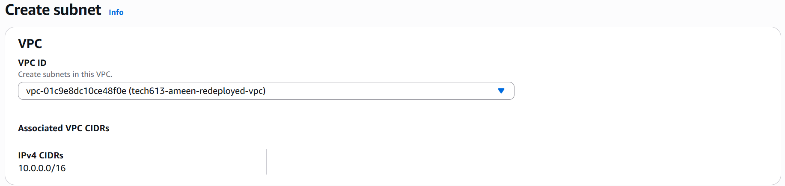
   - 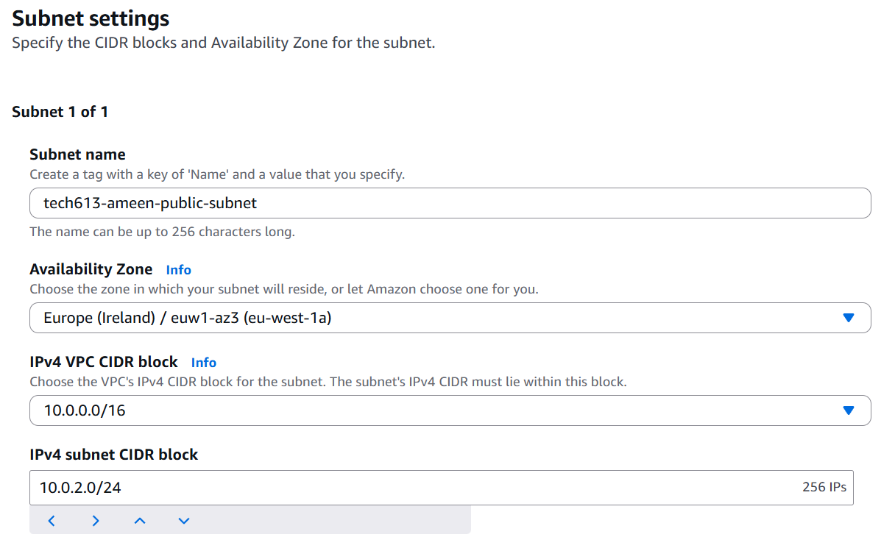
   - 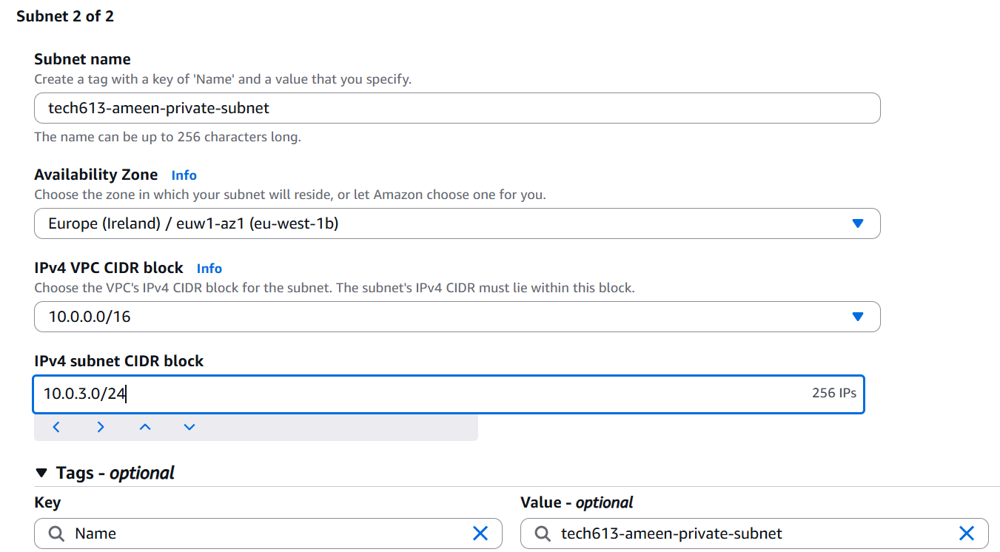


### What and why 

These divide the VPC into separate address ranges for the app and database. Then I configure the routing next, naming them public and private does not establish that distinction yet.

## Create and attach the internet gateway

1. In VPC, I select **Internet gateways**.
2. I click **Create internet gateway**.
3. Name is `tech613-ameen-redeployed-vpc-igw`
4. I click **Create internet gateway**.
5. I select **Actions** then **Attach to VPC**.
6. I choose `tech613-ameen-redeployed-vpc`.
7. I click **Attach internet gateway**.
   - 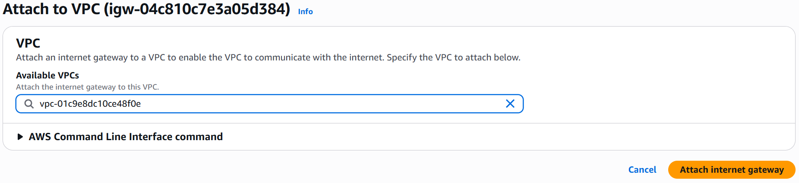

### Why

This provides the internet gateway my public subnet will use. Next, I’ll configure its route table, attaching the gateway alone does not complete internet access.

## Create and configure the public route table

1. In VPC then route tables, I click **Create route table**.
2. Enter:
   - Name: tech613-ameen-redeployed-vpc-public-rt
   - VPC: tech613-ameen-redeployed-vpc
3. I click Create route table.
I associate it with my public subnet:
1. I open Subnet associations then **Edit subnet associations**.
2. I select only tech613-ameen-public-subnet (10.0.2.0/24).
3. I click **Save associations**.
I add the internet route:
1. I open Routes → Edit routes → Add route.
2. Enter:
   - | Destination | Target |
|---|---|
| `0.0.0.0/0` | Internet Gateway → select my newly created gateway |
9. I click **Save changes. Keep the existing local route**.
    - | Destination | Target |
|---|---|
| `10.0.0.0/16` | `local` |
| `0.0.0.0/0` | My internet gateway |
   - 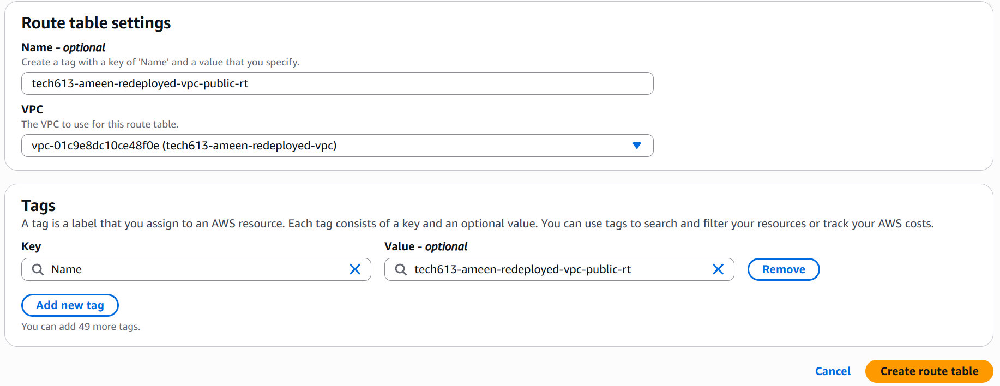
   - 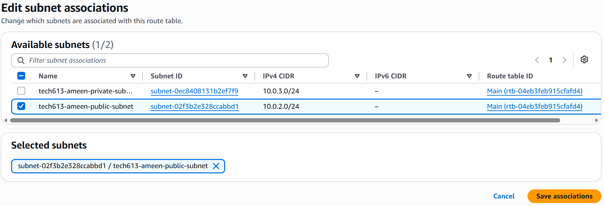
   - 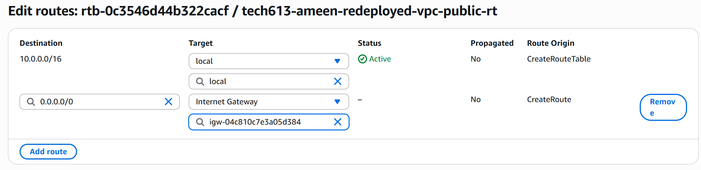

## Check my network using the resource map
1. | Subnet | Route table | Internet gateway route |
|---|---|---|
| Public: `10.0.2.0/24` | My public route table | Yes |
| Private: `10.0.3.0/24` | Automatically created main route table | No |

- 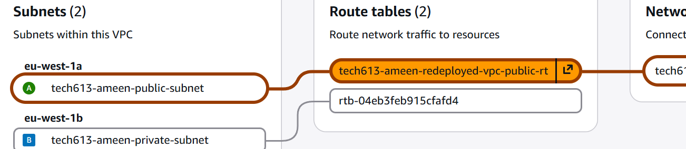
- 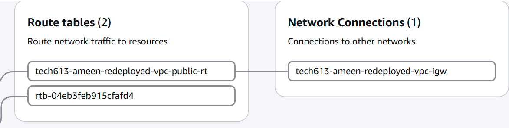

## Launch database instance

1. I go to EC2 then AMIs then Owned by me.
2. I select my prepared MongoDB AMI.
3. I click Launch instance from AMI.
4. Under Network settings then Edit, select:
   - | Setting | Value |
|---|---|
| VPC | `tech613-ameen-redeployed-vpc` |
| Subnet | My private subnet — `10.0.3.0/24` |
| Auto-assign public IP | **Disable** |
5. I select Create security group:
   - Name: tech613-ameen-redeployed-db-sg
   - Description: Allow SSH and MongoDB from the app subnet
6. Inbound rules: 
   - | Type | Port | Source |
|---|---:|---|
| SSH | 22 | Custom: `10.0.2.0/24` |
| Custom TCP | 27017 | Custom: `10.0.2.0/24` |
7. Then **click Launch instance**.

## Lauch app instance 

1. I go to EC2 then AMIs then Owned by me.
2. I select my prepared app AMI that does not auto-start.
3. I click Launch instance from AMI.
4. Enter:
   - | Setting | Value |
|---|---|
| Name | `tech613-ameen-redeployed-app` |
| Instance type | `t3.micro` |
| Key pair | My existing key pair |
5. Under Network settings then Edit, select:
   - | Setting | Value |
|---|---|
| VPC | `tech613-ameen-redeployed-vpc` |
| Subnet | Public subnet — `10.0.2.0/24` |
| Auto-assign public IP | **Enable** |
6. I create a security group named tech613-ameen-redeployed-app-sg with these inbound rules:
   - | Type | Port | Source |
|---|---:|---|
| SSH | 22 | **My IP** |
| HTTP | 80 | **Anywhere-IPv4** — `0.0.0.0/0` |
7. Within the user data section input my start app script and switch the DB-PRIVATE-IP with my actual private ip:
   - ```bash
        #!/bin/bash

        set -e

        cd /home/ubuntu/app

        export MONGODB_URI="mongodb://DB-PRIVATE-IP:27017/tictactoe"

        export PM2_HOME=/root/.pm2

        pm2 restart tictactoe --update-env || pm2 start npm --name tictactoe -- start
     ```

### Why

User data sets the database connection before starting the app. Dependencies are already installed, so leave that out installation and seeding.

## Lauch app instance 

- 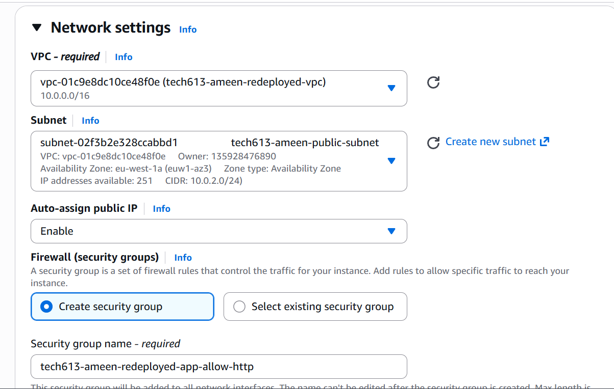
- 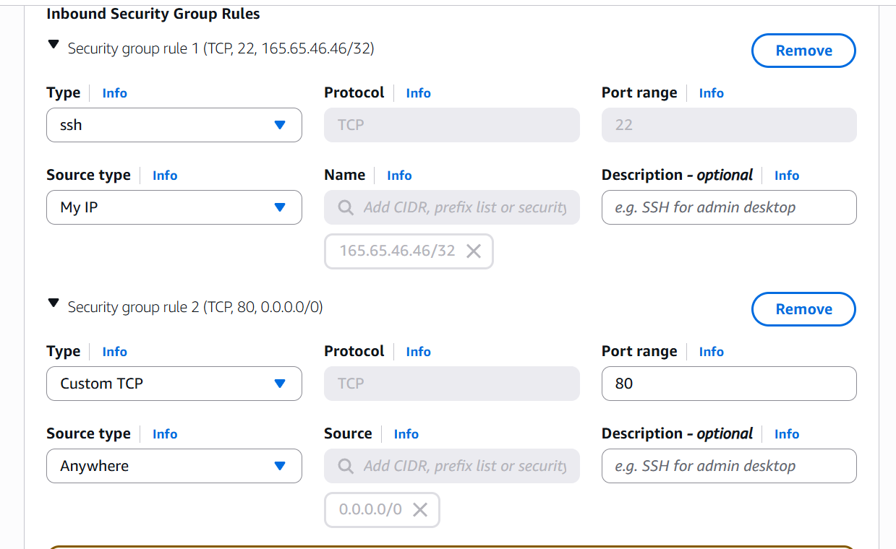
- 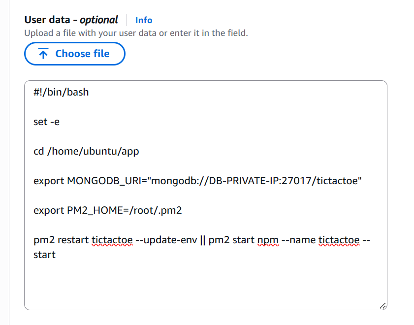

